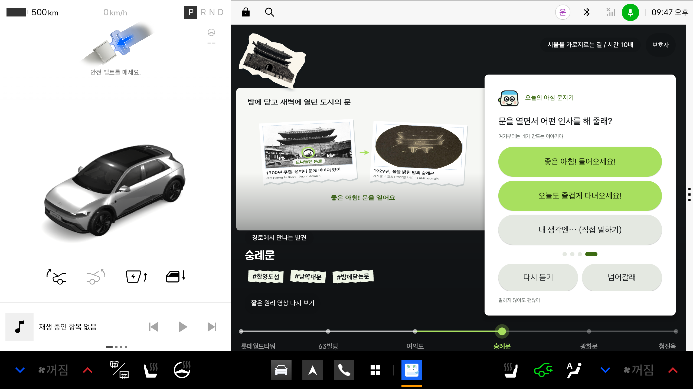
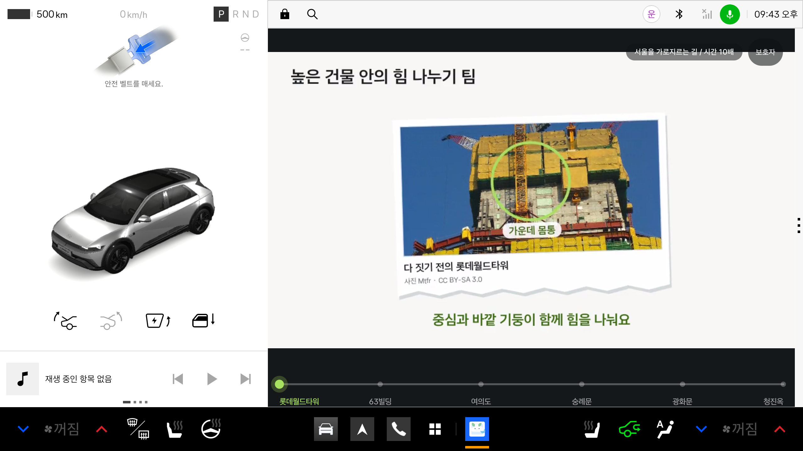
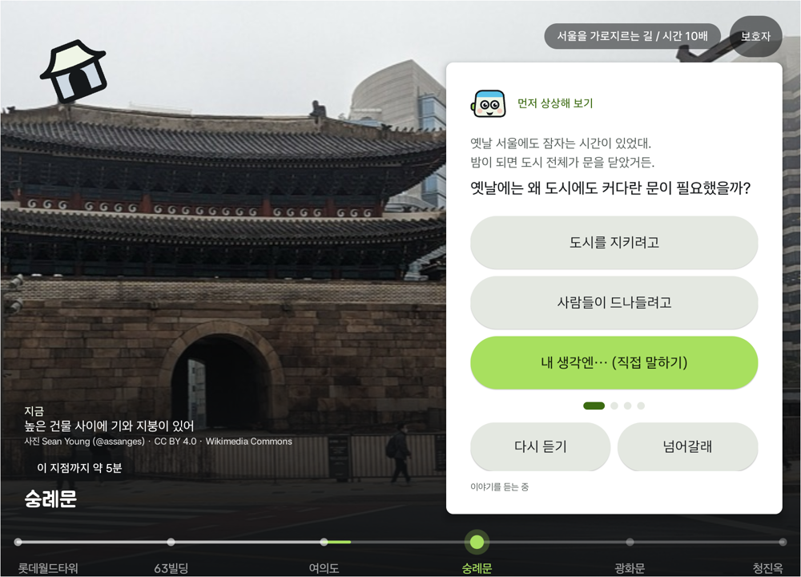
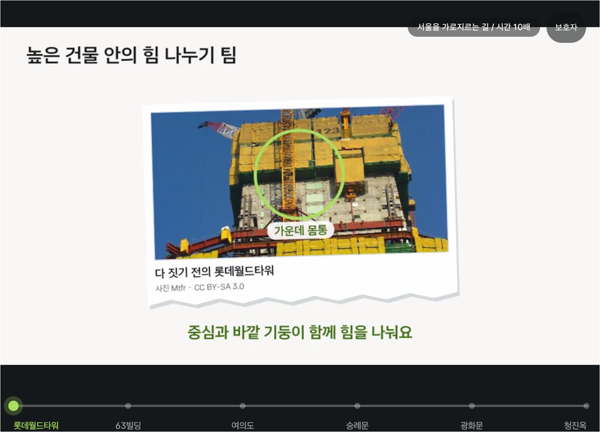

# 창밖을 보라

가는 길에 있는 장소를 아이가 직접 창밖으로 보게 만드는 Pleos Connect 앱입니다. 차가 어느 방향으로 가는지 알기 때문에, 지금 어느 쪽 창을 봐야 하는지까지 말해 줍니다.



| 제출 항목 | 내용 |
|---|---|
| 앱 이름과 한 줄 소개 | **창밖을 보라** · 가는 길의 장소를 아이가 창밖으로 보게 만들고, 어느 쪽 창인지까지 알려 주는 뒷자리 앱 |
| 실행 방법 | [2. 실행 방법](#2-실행-방법) |
| 테스트 환경과 필요한 설정 | [3. 테스트 환경과 필요한 설정](#3-테스트-환경과-필요한-설정) |
| 개발에 사용한 에뮬레이터 버전과 화면 규격 | Pleos Connect v2.1.0(Android 14, API 34) · 가로 2560×1440, 160dpi |
| APK 파일 위치 | [`apk/김김서김김_창밖을보라_release.apk`](apk/김김서김김_창밖을보라_release.apk) |

기획 의도와 심사 항목별 내용은 [기획서](docs/기획서.md)에 있습니다.

## 1. 앱 이름과 한 줄 소개

- **앱 이름**: 창밖을 보라. 저장소와 패키지 이름(`pleos-road-curator`, `dev.changbak.explorer`)은 개발 때 이름을 그대로 씁니다.
- **한 줄 소개**: 가는 길에 있는 장소를 아이가 직접 창밖으로 보게 만드는 Pleos Connect 앱입니다.

6세에서 8세 아이가 뒷자리에서 씁니다. 아이에게 정답을 요구하지 않고, 대답하지 않아도 이야기는 그대로 이어집니다. 한 장소는 다섯 박자로 지나갑니다.

| 박자 | 하는 일 |
|---|---|
| 질문 | 장소가 가까워지면 짧은 질문을 한 번 합니다. 같은 길을 다시 지나면 준비된 질문을 만남 횟수에 따라 순환합니다 |
| 관찰 | **어느 쪽 창인지 알려 주고**, 화면 모서리에 그쪽을 가리키는 표시를 남깁니다 |
| 해설 | 지점을 지나가면 짧은 해설과 **그 장소의 실제 사진**을 신문 스크랩처럼 보여 줍니다 |
| 가족의 기억 | 보호자가 적어 둔 한 줄이 있으면 그 자리에서 들려줍니다 |
| 역할 놀이 | 그 장소의 사람이 되어 한 마디 해 봅니다. 사실과 구분해 "여기부터는 네가 만드는 이야기야"라고 적습니다 |

| 질문 | 창밖 관찰 | 해설 |
|---|---|---|
|  |  |  |

### 어느 쪽 창인지

달리는 차 안의 여섯 살에게 "창밖을 봐"는 어디를 보라는 말인지 알 수 없는 안내입니다. 연속된 두 위치로 차의 진행 방향을 구하고 장소까지의 방위와 비교해 "오른쪽 창밖을 봐"라고 말합니다. 차량 내비게이션의 위치 정보에 연결해 별도 휴대폰 조작 없이 안내합니다.

- 충분히 움직였고 한쪽으로 분명할 때만 말합니다. 애매하거나 이미 지나친 뒤쪽이면 방향을 말하지 않습니다.
- 말은 한 번뿐이므로 관찰하는 동안 화면 모서리에 화살표 한 개와 한 단어가 남습니다. 사진 속 건물이 그 모서리에 있으면 반대편으로 옮겨 가리지 않습니다.
- 방향을 알려 줄 뿐, 아이가 실제로 보았는지는 판정하지 않습니다. 아이가 답했을 때만 보았다고 기록합니다.

### 다루는 장소

앱에 들어 있는 검증된 서울 6곳입니다. 인터넷 전체 검색이나 자동 수집이 아닙니다.

| 장소 | 다루는 내용 |
|---|---|
| 롯데월드타워 | 중심부와 바깥 기둥이 힘을 나누는 방식 |
| 63빌딩 | 내부 뼈대와 커튼월[바깥을 감싸는 외벽]의 역할 |
| 여의도 | 모래섬에서 비행장을 거쳐 도시가 된 변화 |
| 숭례문 | 도시의 출입문 |
| 광화문 | 궁궐의 출입문 |
| 청진옥 | 서울미래유산에 기록된 1937년 개업과 3대 계승 |

- 시연은 이 여섯 곳을 동쪽에서 서쪽으로 지나는 길 하나로 고정했습니다. 롯데월드타워 → 63빌딩 → 여의도 → 숭례문 → 광화문 → 청진옥. 앞의 세 곳이 건물과 땅의 과학을, 뒤의 세 곳이 사람들의 이야기를 맡습니다.
- GPS 주변 탐색 대상은 여의도를 제외한 5곳입니다. 여의도는 넓은 지역이라 단일 통과점을 만들지 않았습니다.
- 가게의 현재 영업 여부나 현재 운영자 정보는 보장하지 않습니다. 역사적 기록으로만 표현합니다.

### 화면에 나오는 사진

창밖에서 "어? 이거구나" 하려면 도형이 아니라 그 장소의 실제 모습을 먼저 봐야 합니다. 질문과 관찰 단계에서 그 장소의 사진을 보여 주고, 해설도 사진을 오려 붙여 만듭니다.

| 쓰는 곳 | 장소 | 촬영자 | 라이선스 |
|---|---|---|---|
| 질문·관찰 | 롯데월드타워 | Ox1997cow | CC BY 3.0 |
| 질문·관찰 | 63빌딩 | Sebastian Hoering | CC BY-SA 4.0 |
| 질문·관찰 | 여의도 | Ox1997cow | CC BY-SA 3.0 |
| 질문·관찰 | 숭례문 | Sean Young (@assanges) | CC BY 4.0 |
| 질문·관찰 | 광화문 | Huntsmanleader | CC0 |
| 해설 | 롯데월드타워(공사 중) | Mtfr | CC BY-SA 3.0 |
| 해설 | 63빌딩(1984년 / 지금) | 서울사진아카이브 / Maris Teteris | CC BY 3.0 |
| 해설 | 여의도(1969년 / 지금) | 경기도청 / Ox1997cow | 공개 자료 / CC BY-SA 3.0 |
| 해설 | 숭례문(1900년 무렵 / 1929년 밤) | Homer Hulbert / 미상 | 공개 자료 |
| 해설 | 광화문(수문장 / 경복궁 교대식) | Frank Schulenburg / Garam | CC BY-SA 4.0 / Attribution |
| 해설 | 청진옥(1999년 청진동 골목) | 서울연구원 | CC BY 4.0 |

- 장소마다 그 장소의 사진만 씁니다. 다른 장소의 사진을 빌려 쓰지 않고, 쓸 사진이 없으면 넣지 않습니다.
- 사진은 화면에 있는 동안 **촬영자와 라이선스를 함께** 보여 줍니다. 둘이 적히지 않은 사진은 코드가 화면에 내보내지 않습니다.
- **AI로 만든 이미지는 넣지 않습니다.** 없던 모습을 지어내 아이에게 사실로 보여 주는 일이기 때문입니다.
- 원본 주소는 [`native-app/app/src/main/assets/scenes/README.md`](native-app/app/src/main/assets/scenes/README.md)와 `domain/PhotoStages.kt`에 있습니다.

### 가족의 기억

보호자가 `보호자` 메뉴에서 장소와 한 줄을 적어 두면, 그 길을 지날 때 해설 뒤에 들려줍니다.

> 그런데 있잖아. 여기에는 엄마 아빠가 너한테 들려주고 싶은 이야기가 있어.
> 엄마랑 아빠가 처음 만난 곳이야. 그날도 눈이 왔었어.
> 창밖에 그 자리가 있어. 그때 엄마 아빠는 어떤 마음이었을까?

- 보호자가 적은 문장이 곧 해설입니다. 앱이 고쳐 쓰거나 번역하거나 지어내지 않습니다.
- 보호자가 쓴 이야기에는 기억을 묻지 않습니다. 아이가 그 자리에 없었던 이야기이기 때문입니다.
- 차를 세운 곳을 가족의 장소로 더할 수도 있습니다. 할머니 집, 아이가 태어난 병원처럼 앱의 6곳이 담을 수 없는 장소입니다. 그 장소에는 그림도 영상도 넣지 않습니다.
- 기록과 위치는 차 안에만 저장하고 어디로도 보내지 않습니다.

### 두리

아이에게 말을 거는 캐릭터입니다. 차 창문에 얼굴이 있고 왼쪽에 사이드미러가 하나 달려 있습니다. 앱이 부탁하는 일이 창밖 보기라서, 묻는 쪽의 생김새와 하는 일을 같게 했습니다. 가만히 있을 때도 천천히 숨을 쉬고 눈을 깜빡이며, 말할 때 입이 열리고 아이 말을 들을 때 눈이 웃는 호가 됩니다.

### 차량 환경에 맞춘 점

| 항목 | 하는 일 |
|---|---|
| 주행 제한 | 운행 중에는 영상과 터치를 제한하고 음성만 이어갑니다. 제한을 해제하거나 회피하지 않습니다 |
| 정차 판단 | 기어와 브레이크 페달로 차가 선 순간에만 짧은 영상을 권합니다. 후진 중에는 권하지 않습니다 |
| 오디오 | 발화마다 차량 오디오 우선순위를 얻고 잃으면 멈춥니다. 음악 채널이 아니라 안내 채널로 내보냅니다 |
| 화면 밖 | 전경 서비스로 동작해 아이가 창밖을 보는 동안에도 음성이 이어집니다. 이 서비스는 마이크를 쓰지 않습니다 |
| 내비 | 조회만 합니다. 운전자의 경로를 바꾸지 않고 목적지나 경유지를 자동으로 추가하지 않습니다 |

## 2. 실행 방법

### 2-1. 에뮬레이터 준비

Pleos Connect 에뮬레이터는 [공식 안내](https://document.pleos.ai/docs/connect/guide/getting-started/application-development/setup-connect-sdk-emulator)대로 설치합니다.

```bash
emulator -avd pleos -no-snapshot &      # pleos 자리에 만든 AVD 이름
adb devices                             # 기기가 보이는지 확인
```

### 2-2. release APK로 설치해 보기

```bash
adb install -r apk/김김서김김_창밖을보라_release.apk
adb shell am start -n dev.changbak.explorer/.MainActivity
```

- 설치 후 앱에서 위치 권한을 허용해야 실제 운행 기능이 동작합니다. 권한 없이도 정차 시연 흐름은 모두 볼 수 있습니다.
- 첫 화면에서 **서울을 가로지르는 길**을 누르면 여섯 장소를 순서대로 지나는 시연이 시간 10배로 자동 진행됩니다. 한 번 누른 뒤에는 아무것도 누르지 않아도 됩니다.

### 2-3. 보고 싶은 장면으로 바로 가기

`보호자` → `시점 이동해서 확인`에서 장소와 시점(약 5분 전 / 가까이 / 통과)을 고르면 그 장면으로 바로 갑니다. 같은 메뉴에서 아이 설정(한국어·영어, 관심사), 뒷자리 말하기, 가족의 기억 기록, 질문을 처음 만남으로 되돌리기를 할 수 있습니다.

### 2-4. 소스에서 빌드하기

```bash
cd native-app

# 자기 환경에 맞는 경로를 적습니다. 이 파일은 저장소에 올라가지 않습니다.
cat > local.properties <<'EOF'
sdk.dir=/path/to/android-sdk
org.gradle.java.home=/path/to/jdk-21
EOF

./gradlew testDebugUnitTest assembleDebug     # 단위 검사 390개와 디버그 빌드
./gradlew assembleRelease                     # 서명은 keystore.properties 가 있을 때만
```

기기에서 도는 검사는 다음과 같습니다.

```bash
./gradlew installDebug installDebugAndroidTest
adb shell am instrument -w -e check curator       dev.changbak.explorer.test/dev.changbak.explorer.SceneRenderCheck
adb shell am instrument -w -e check curator-media dev.changbak.explorer.test/dev.changbak.explorer.SceneRenderCheck
adb shell am instrument -w -e check stickers      dev.changbak.explorer.test/dev.changbak.explorer.SceneRenderCheck
```

## 3. 테스트 환경과 필요한 설정

| 항목 | 값 |
|---|---|
| 개발 컴퓨터 | macOS 26(Apple Silicon), Windows 11에서도 빌드 확인 |
| 빌드 도구 | JDK Temurin 21, Gradle 9.3.1(래퍼 포함), Android Gradle Plugin 9.1.0, Kotlin |
| Android SDK | compileSdk 34, targetSdk 34, minSdk 28, build-tools 36.0.0 |
| Pleos SDK | NaviHelper 3.0.5, Vehicle 2.3.2, TextToSpeech 3.3.1, SpeechToText 3.3.1 |
| 화면 구현 | Android 기본 View와 Canvas만 사용. 외부 UI 라이브러리 없음 |
| 권한 | `pleos.car.permission.NAVI_ROUTE`·`CAR_DRIVE`(조회만), `TTS_SERVICE`, `STT_SERVICE`, 위치(`ACCESS_FINE_LOCATION`·`ACCESS_COARSE_LOCATION`, 실제 여행을 시작할 때 요청), 전경 서비스. 차량 제어 권한은 없습니다 |

**필요한 설정**

- **Pleos SDK 저장소**: Pleos Playground Maven이 Gradle 설정에 들어 있습니다. 처음 빌드할 때 인터넷 연결이 필요하고, 따로 넣을 키는 없습니다.
- **Android SDK 위치**: `local.properties`를 만들거나 `ANDROID_HOME`을 지정합니다(저장소에는 없습니다).
- **서명**: `native-app/keystore.properties`가 있을 때만 release가 서명됩니다. 키 파일과 비밀번호는 저장소에 없습니다. [`signing/README.md`](signing/README.md)를 보세요.
- **네트워크 키 없음**: 외부 AI를 호출하지 않습니다. 키 없이 빌드하고 실행할 수 있습니다.

## 4. 개발에 사용한 Pleos Connect 에뮬레이터 버전과 화면 규격

| 항목 | 값 |
|---|---|
| 에뮬레이터 | **Pleos Connect v2.1.0** |
| Android | 14(API 34) |
| 화면 규격 | **가로 2560×1440, 160dpi**(1dp = 1px) |
| 앱 창 | 1682×1210dp. 저장소의 화면 캡처는 이 영역을 잘라 낸 것입니다 |
| 확인한 기기 | Pleos Connect 에뮬레이터, Android Automotive 에뮬레이터[API 33, arm64] |

## 5. APK 파일 위치

| 빌드 | 위치 | 쓰임 |
|---|---|---|
| release | [`apk/김김서김김_창밖을보라_release.apk`](apk/김김서김김_창밖을보라_release.apk) | 설치해 보기(2-2). 0.48.0, versionCode 50, `apksigner verify` 통과 |
| debug | `native-app/app/build/outputs/apk/debug/app-debug.apk`(빌드하면 생기고, 저장소에는 없습니다) | 기기 검사(2-4) |

## 확인한 것

- `./gradlew testDebugUnitTest`: 자동 검사 390개 통과, 실패 0, 오류 0
- `./gradlew assembleDebug assembleRelease`: 성공. 서명된 release APK는 `apksigner verify` 통과
- Pleos Connect 에뮬레이터에서 고정 경로 여섯 곳을 한 번의 터치 뒤 마무리 카드까지 연속 진행. 충돌 0회
- 기기 검사 3종 통과: 시연 흐름, 장소별 MP4 6개의 디코딩과 움직임, 작은 그림 17개와 설명 사진 10장과 두리의 세 가지 상태
- 실제 SDK 조회에서 경로 상태, 현재 위치, 목적지, 경유지 콜백 수신. 오류 0
- 해설 도중 음성 엔진을 강제 종료해도 화면이 멈추지 않고 다음 단계로 넘어감

화면과 영상은 `validation/` 아래 버전별 폴더에 있습니다.

## 한계

- **실제 주행은 확인하지 못했습니다.** 약 5분 전 안내부터 통과까지의 전체 운행, 좌우 방향 안내의 실제 주행 확인, 정차 순간 판단의 실제 차량 확인이 남아 있습니다. 에뮬레이터 내비는 가상 위치를 받지 않아 이 조건을 만들 수 없습니다.
- **소리 크기를 귀로 확인하지 못했습니다.** 음성을 음악 채널에서 안내 채널로 옮겼지만, 에뮬레이터의 음성 엔진은 소리를 낼 장치가 없습니다. 같은 길이의 구간에서 두 채널의 오디오 오류 수가 같았습니다.
- **실제 아이의 음성 인식을 확인하지 못했습니다.** 뒷자리 말하기는 코드와 단위 검사까지 되어 있고, 아이 목소리로는 시험하지 않았습니다.
- **전체 경로 좌표를 받는 방법을 현재 공개 SDK에서 확인하지 못했습니다.** 그래서 등록된 목적지와 경유지는 해당 지점의 예상 시간을 쓰고, 등록되지 않은 주변 장소는 GPS 접근과 멀어짐으로만 처리합니다. 주변 장소에는 몇 분 뒤라고 말하지 않습니다.
- **청진옥은 가게 자체의 사진이 없습니다.** 1999년 청진동 골목 사진에 찍힌 가게 간판을 동그라미로 가리킵니다.
- 아이가 실제로 쓰는 모습은 시험하지 못했습니다. 뒷자리 가독성과 질문의 난이도는 어른의 판단입니다.

## 저장소 구조

| 경로 | 내용 |
|---|---|
| `native-app` | Android 프로젝트. 이 폴더를 Android Studio에서 엽니다 |
| `apk` | 제출용 release APK |
| `docs` | 기획서, 발표자료, 개발 환경, 점검 기록 |
| `validation` | 버전별 에뮬레이터 화면, 시연 영상, 검증 보고 |
| `signing` | 서명 키 안내. 키 파일과 비밀번호는 저장소에 없습니다 |
| `media` | 설명 영상과 미리보기 이미지 |
| `tools` | 에뮬레이터 확인 도구, 사진 누끼 도구 |
| `history`, `legacy-web` | 이전 버전과 예전 웹 프로토타입. 현재 실행 경로가 아닙니다 |
| `CLAUDE.md` | 기획 의도, 구현 제약, 남은 작업을 적은 작업 지침 |

## 개인정보 처리

- 현재 위치, 주소, 목적지 이름, 아이 음성의 원문을 기록으로 남기거나 외부 서비스로 보내지 않습니다.
- 보호자가 적은 가족의 기억과 위치는 차 안에만 저장합니다.
- 외부 AI를 호출하지 않습니다. 마이크는 보호자가 켜고 아이가 답할 때만 열리며, 전경 서비스는 마이크를 쓰지 않습니다.
